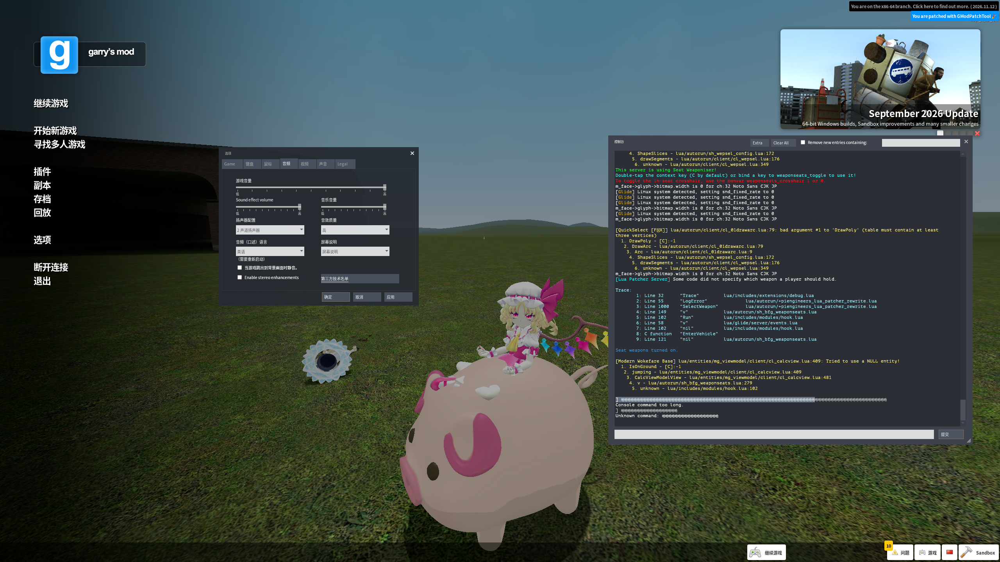
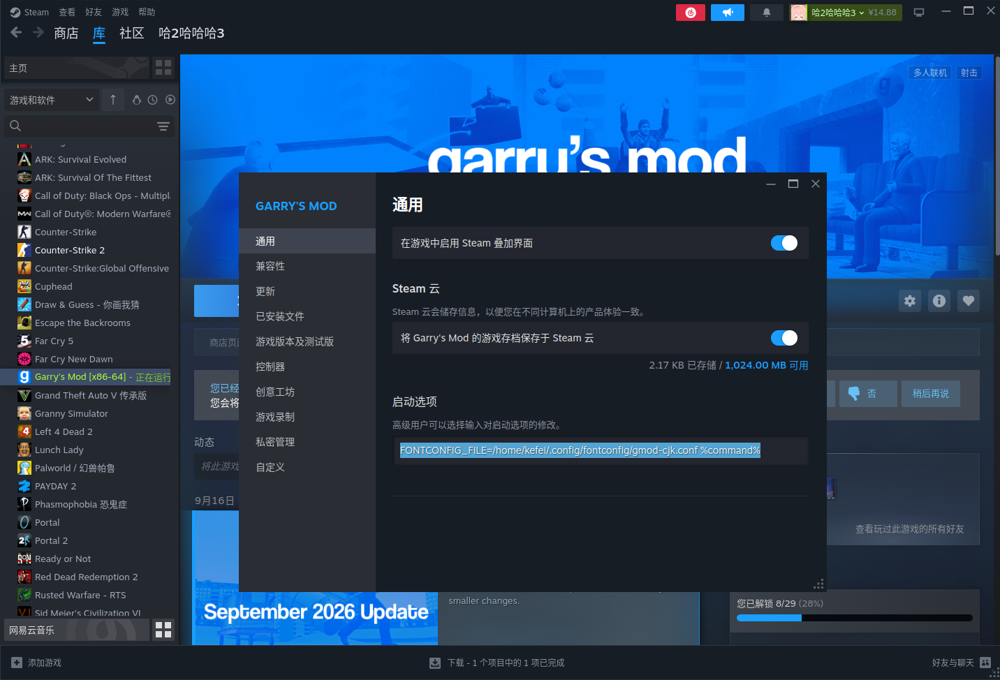

# GMOD-Linux-CJK-Fix

这是一个解决 Gmod Linux 版本的 CJK 字体口口口问题的项目

由于 GMod 在 Linux 上把字体固定成 DejaVu Sans、Tahoma、Verdana 这些 Windows 字体

而这些字体没有中文字形，起源引擎又不会自动逐字回退，所以中文全变成 口口口

即使系统里其实有 Noto CJK，但游戏没有用上它 😅😅😅


# 展示



# 使用方法

> 小提示: 你要是懒可以复制下面的话让ai来弄
>
> 克隆 https://github.com/TATyKeFei/GMOD-Linux-CJK-Fix 仓库
>
> 根据 ReadME.md 的教程安装这个项目，如未安装 noto-sans-cjk 字体帮我安装下
>
> 最后提醒我更改 Steam 的 Gmod 游戏启动项

## 安装 Noto Sans CJK 字体

```
# Arch系
sudo pacman -S noto-fonts noto-fonts-cjk
```

其他发行版的包名我不知道，我只用 Arch

## 安装 FontConfig

将仓库内的 `fontconfig` 文件夹移动到 `~/.config/fontconfig/` 你也可以移动别处，但建议在这里

## 更改启动项

右键 Gmod 属性更改启动项

```
FONTCONFIG_FILE=~/.config/fontconfig/gmod-cjk.conf %command%
```



现在启动你的游戏就能看到中日韩字符而不是口口口了，希望能帮到你
